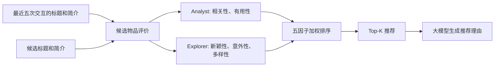

# 基于大语言模型的惊喜度推荐算法设计与实现

> 本科毕业设计：将用户兴趣匹配与探索需求拆分为两个角色的五维评分任务，完成候选物品重排和自然语言推荐解释。

项目以电影推荐为主要实验场景，同时包含书籍领域的数据构建和评估脚本。目标是探索如何推荐用户可能喜欢、又不完全符合其已有消费模式的内容。

## 方法



- **数据构建**：清洗 SerenLens 交互数据、补全标题和简介，按时间构建五条历史加一条目标的滑动窗口。
- **监督标签**：教师模型结合历史、目标信息、真实评论和二元惊喜标签，生成 1–5 分的五维辅助标签。学生模型输入只包含历史与目标的标题、简介。
- **双角色评分**：围绕 `Qwen2.5-7B-Instruct` 与 LoRA 适配器，Analyst 预测 relevance、utility，Explorer 预测 novelty、unexpectedness、diversity。角色通过评分融合协作。
- **排序**：在验证集上网格搜索非负权重，使用五因子加权和完成重排。现有搜索脚本约束各权重至少为 1、总和为 10、步长为 0.5，并以 HR@10 为目标。
- **演示**：提供离线评分加在线解释的 Streamlit 页面，以及串行加载两个角色适配器的本地推理脚本。

## 快速体验

### 无模型、无 API 的排序示例

安装 Python 3.10 或更高版本，在仓库根目录运行：

```bash
python examples/rerank_demo.py
```

该命令只依赖 Python 标准库。示例中的电影、历史和评分均为虚构且手工编写，不代表模型实验结果。

### Streamlit 页面

```bash
python -m pip install -r requirements-demo.txt
python -m streamlit run 系统演示/webui.py
```

当本地完整预测文件不存在时，页面自动使用 `examples/` 中的虚构评分，展示五因子和 Top-3。生成推荐理由需要在侧边栏输入自己的 OpenRouter API Key；未配置时仍可查看排序。

可通过环境变量设置密钥。PowerShell 示例：

```powershell
$env:OPENROUTER_API_KEY = "你的密钥"
python -m streamlit run 系统演示/webui.py
```

其他配置见 [.env.example](.env.example)。脚本不自动读取 `.env`，请在启动进程前设置环境变量。需要代理时设置 `OPENROUTER_PROXY`，默认不使用代理。

## 目录

| 目录 | 内容 |
|---|---|
| `标题简介补全/` | 元数据补全、检查与合并 |
| `构建电影数据集/` | 用户序列、数据划分、教师打分、指令数据生成 |
| `构建书籍测试集/` | 书籍元数据、测试集和五维标签构建 |
| `随机采样合适参数/`、`细粒度合适参数/`、`信息茧房合适参数/` | 三种候选场景构建、验证/测试切分、权重搜索 |
| 对应的 `系统推荐测试/` | 预测输入准备与排序评估 |
| `信息茧房系统推荐测试/` | 完整系统、角色消融、基线与权重敏感性分析 |
| `测试结果评估/` | 五维评分的 MAE、RMSE、Pearson 相关性等 |
| `基线测试与对比/` | TF-IDF 内容推荐和大模型直接打分脚本 |
| `系统演示/` | 本地适配器推理流程和 Streamlit 页面 |
| `examples/` | 可公开运行的虚构样例 |
| `scripts/`、`results/` | 严格检查对齐的复评脚本和汇总指标 |

## 数据与完整实验

原始数据、完整生成数据、用户记录、数据库、模型权重和论文 PDF 不随仓库分发。请从数据提供方取得 SerenLens，遵守其使用条件，再恢复或生成相应本地文件。`examples/` 不能用于替代正式评测数据。

现有本地电影数据统计：训练集 **9,040 条 / 472 名用户**，测试集 **2,060 条 / 118 名用户**，训练和测试用户无重叠。训练/测试样本中惊喜与非惊喜样本比例为 1:19。书籍领域构建了 1,000 条测试样本。

完整流水线如下：

1. 运行元数据补全与序列构建脚本，生成电影标题、简介和按时间排列的用户记录。
2. 运行 `构建电影数据集/2_数据集切分.py`，构建滑动窗口并划分训练/测试用户。
3. 配置 `OPENROUTER_API_KEY`，运行教师打分脚本和 `4_生成llama_factory数据.py`，生成 Analyst / Explorer 指令数据。
4. 在 LLaMA-Factory 中分别训练两个角色的 LoRA 适配器。本仓库不包含训练权重或可核实的训练超参数配置，需自行配置训练环境。
5. 构建二十候选的排序任务：一个真实惊喜目标与十九个采样候选。三种场景分别使用随机候选、与目标文本相似的候选、与历史文本相似的候选。
6. 在验证集上搜索权重，用最终测试集评估。运行完整脚本前，需要把历史脚本中的 `lzc/...`、服务器模型路径等修改为自己的路径，并准备对应预测文件。

完整依赖见 `requirements.txt`；PyTorch/CUDA 和 LLaMA-Factory 应根据实际 GPU 环境安装。轻量演示无需完整训练依赖。本地推理脚本支持 `BASE_MODEL_PATH`、`ANALYST_ADAPTER` 和 `EXPLORER_ADAPTER` 环境变量，运行前仍需准备适配器及脚本要求的原始任务文件。

## 实验结果

以下指标从本地保存的模型预测中重新计算，未重新训练或执行模型推理。每种电影场景的最终测试集有 **62 组任务、57 名不同用户，每组 20 个候选**。详细数值见 [results/movie_ranking_metrics.json](results/movie_ranking_metrics.json)。

| 双角色方案的候选场景 | HR@10 | NDCG@10 | MRR | AUC |
|---|---:|---:|---:|---:|
| 随机候选 | 0.6129 | 0.2566 | 0.1791 | 0.5497 |
| 与目标相似 | 0.5484 | 0.2830 | 0.2361 | 0.5441 |
| 与用户历史相似（信息茧房模拟） | 0.7097 | 0.3867 | 0.3115 | 0.6439 |

信息茧房模拟场景的角色消融：

| 方案 | HR@10 | NDCG@10 | MRR | AUC |
|---|---:|---:|---:|---:|
| 仅 Analyst | 0.7258 | 0.3418 | 0.2449 | 0.6053 |
| 仅 Explorer | 0.6935 | 0.3608 | 0.2841 | 0.6286 |
| 双角色融合 | 0.7097 | 0.3867 | 0.3115 | 0.6439 |

双角色融合在该场景的 NDCG、MRR 和 AUC 上优于两项单角色配置，HR@10 略低于仅 Analyst。在随机和目标相似场景，本地复评没有显示双角色方法优于 TF-IDF，因此不主张跨场景全面领先。

恢复完整数据和预测后，可以从仓库根目录复算：

```bash
python scripts/evaluate_saved_predictions.py --output results/movie_ranking_metrics.json
```

该脚本检查候选数量和预测标题对齐，缺失或错位时直接报错。汇总 JSON 只包含统计值，不含用户记录。

## 实验边界

- 五维监督分数来自教师模型辅助标注，并非人工五维真实评分；原始二元惊喜标签与五维辅助标签需区分。
- 采样候选作为评测负例，并不等于用户对它们表达了真实负反馈。信息茧房模拟基于历史相似度构造，对相似度推荐方法存在结构性不利。
- 排序验证/测试按任务组随机切分，存在五名用户重叠；训练/测试的用户隔离不等同于排序验证/测试也完全隔离。
- 目前规模较小，未提供线上 A/B 测试或统计显著性结论；生成推荐理由的事实准确性也需要额外验证。
- 两个角色的本地推理采用分阶段加载与释放模型的实现，尚未验证生产环境并发、吞吐或延迟。

## 凭据与发布范围

API 凭据通过环境变量或页面密码输入框配置。请勿提交密钥、`.env` 或模型服务凭据。

仓库用于毕业设计代码展示与研究复现说明。完整数据、第三方模型和文献的使用条件以各自提供方为准。
